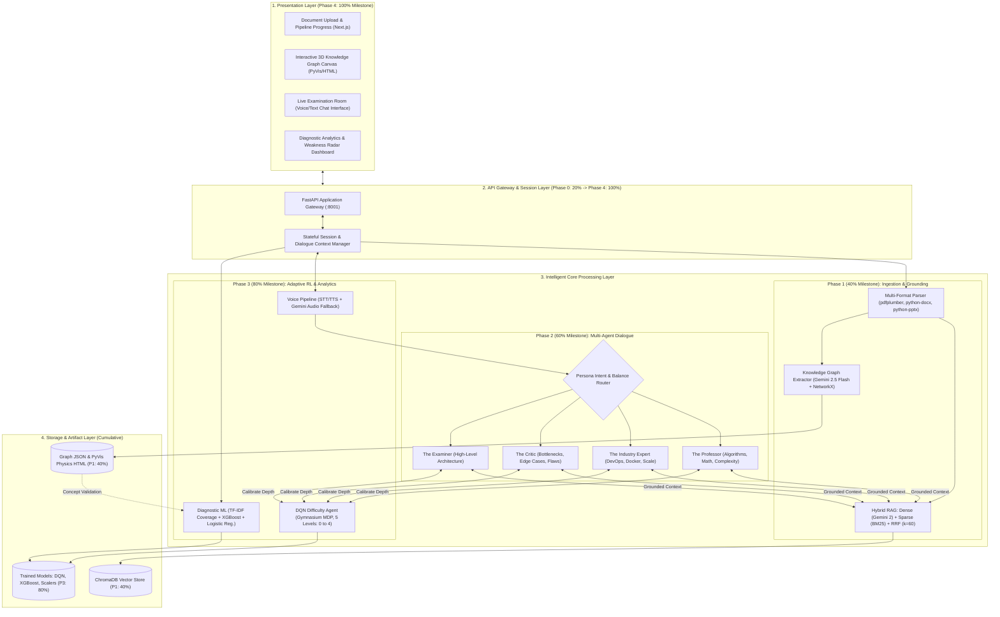
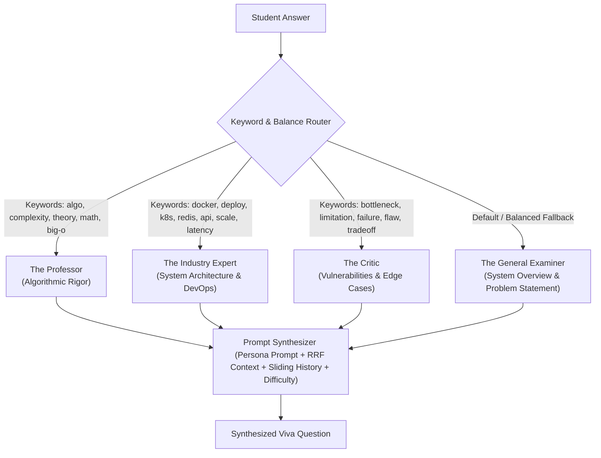

# AIVA: Adaptive Multi-Agent Viva Assessment Framework
## Master Comprehensive Technical Report & Architectural Specification Across All Project Phases (20%, 40%, 60%, 80%, 100%)

---

## Executive Summary

The **Adaptive Multi-Agent Viva Assessment Framework (AIVA)** is an autonomous, research-grade oral examination platform designed to evaluate engineering and computing students on their technical dissertation reports. Traditional oral vivas suffer from significant evaluator subjectivity, human fatigue during intensive grading periods, and a reliance on static, generic question pools due to the prohibitive time required to review multi-hundred-page dissertations.

AIVA resolves these challenges through a modular five-phase architectural lifecycle:
1. **Phase 0 (20% Milestone):** Software Requirements Specification (SRS), Architectural Blueprinting, Data Flow Diagrams (DFD Level 0/1), and API interface stubs.
2. **Phase 1 (40% Milestone):** Multi-format document ingestion (PDF, DOCX, PPTX), Hybrid RAG with Reciprocal Rank Fusion ($k=60$), and 3D force-directed Knowledge Graph extraction.
3. **Phase 2 (60% Milestone):** Explainable multi-agent examiner panel with dynamic semantic routing across four academic personas (*The Professor*, *The Industry Expert*, *The Critic*, *The General Examiner*).
4. **Phase 3 (80% Milestone):** Real-time adaptive difficulty control using Deep Q-Learning (Gymnasium + DQN), resilient multimodal voice fallback, and post-viva diagnostic analytics (TF-IDF concept coverage, XGBoost weakness classification, and Logistic Regression pass prediction).
5. **Phase 4 (100% Milestone):** End-to-end integration with a Next.js 16 / React 19 glassmorphism web dashboard, automated backend microservice verification, empirical benchmark evaluations, and final dissertation defense documentation.

---

## 1. Master Architectural Diagrams Across All Phases

### 1.1 Complete Layered System Architecture
The following diagram illustrates the complete end-to-end system architecture and indicates the phase in which each engine, pipeline, and storage module is introduced:



---

### 1.2 Phase Evolution & Delivery Roadmap
This progression flow diagram shows the sequential pipeline dependencies, inputs, and outputs across each milestone:

```mermaid
flowchart LR
    classDef p20 fill:#1e293b,stroke:#64748b,stroke-width:2px,color:#f8fafc;
    classDef p40 fill:#0f3854,stroke:#0284c7,stroke-width:2px,color:#f8fafc;
    classDef p60 fill:#1e1b4b,stroke:#6366f1,stroke-width:2px,color:#f8fafc;
    classDef p80 fill:#3b0764,stroke:#a855f7,stroke-width:2px,color:#f8fafc;
    classDef p100 fill:#064e3b,stroke:#10b981,stroke-width:2px,color:#f8fafc;

    subgraph S0["Phase 0: 20%"]
        direction TB
        M0["System Specification<br/>• SRS & Synopsis<br/>• DFD Level 0 & 1<br/>• Interface Stubs"]
    end
    class S0 p20;

    subgraph S1["Phase 1: 40%"]
        direction TB
        M1["Grounding Foundation<br/>• Multi-Format Parsers<br/>• Hybrid RAG (RRF k=60)<br/>• 3D Knowledge Graph"]
    end
    class S1 p40;

    subgraph S2["Phase 2: 60%"]
        direction TB
        M2["Conversational Panel<br/>• 4 Examiner Personas<br/>• Dynamic Intent Router<br/>• Context History Window"]
    end
    class S2 p60;

    subgraph S3["Phase 3: 80%"]
        direction TB
        M3["Intelligence & Analytics<br/>• Gymnasium DQN (5 Levels)<br/>• Gemini Voice Fallback<br/>• XGBoost Weakness Model"]
    end
    class S3 p80;

    subgraph S4["Phase 4: 100%"]
        direction TB
        M4["Full Integration<br/>• Next.js 16 Web Dashboard<br/>• Unified FastAPI (:8001)<br/>• Dissertation & Defense"]
    end
    class S4 p100;

    S0 -->|Architecture Blueprint| S1
    S1 -->|RAG Context & KG Nodes| S2
    S2 -->|Dialogue & Turn Scores| S3
    S3 -->|Validated ML Models| S4
```



---

### 1.3 Data Flow Diagrams (DFD)

#### DFD Level 0: Macro Context Diagram
```mermaid
flowchart LR
    Student(("Student / Examinee"))
    AIVA["AIVA Autonomous Assessment System"]
    Faculty(("Faculty / Evaluators"))

    Student -->|1. Uploads Dissertation (PDF/DOCX/PPTX)| AIVA
    Student -->|2. Submits Live Audio/Text Responses| AIVA
    AIVA -->|3. Presents Grounded Viva Questions| Student
    AIVA -->|4. Renders Interactive 3D Knowledge Graph| Student
    AIVA -->|5. Real-Time Difficulty Feedback| Student
    AIVA -->|6. Generates Diagnostic Performance & Weakness Report| Faculty
```

#### DFD Level 1: Functional Decomposition
```mermaid
flowchart TD
    Doc["Student Report"] --> P1["1.0 Multi-Format Parsing & Text Normalization"]
    P1 -->|Clean Chunks| P2["2.0 Hybrid Indexing (Dense ChromaDB + Sparse BM25)"]
    P1 -->|Raw Text| P3["3.0 Entity-Relation Knowledge Graph Extraction"]
    P2 -->|Vector & Inverted Indices| DS1[("ChromaDB & BM25 Store")]
    P3 -->|Nodes & Edges| DS2[("Knowledge Graph Store")]

    Ans["Student Viva Answer"] --> P4["4.0 Voice Transcription & Keyword Extraction"]
    P4 -->|Keywords & History| P5["5.0 Persona Routing (Prof, Industry, Critic, Gen)"]
    P4 -->|Response Score & Window| P6["6.0 RL Difficulty Calibration (DQN)"]
    P6 -->|Difficulty Level (0-4)| P7["7.0 Grounded Question Synthesis"]
    DS1 -->|Top-k RRF Chunks| P7
    P5 -->|Active Persona Prompt| P7
    P7 -->|Next Viva Question| VivaRoom["Interactive Viva Interface"]

    Ans --> P8["8.0 Performance Analytics Engine"]
    DS2 -->|KG Concepts| P8
    P8 -->|TF-IDF Coverage, Weakness Flag, Pass %| Report["Student Diagnostic Radar"]
```

---

## 2. Phase 0: 20% Milestone Report — System Architecture & Design Specification

### 2.1 Overview & Milestone Focus
The 20% milestone establishes the architectural foundation, formal requirements, design constraints, and technological selections. It proves the architectural feasibility of combining Retrieval-Augmented Generation, Graph Theory, Multi-Agent Systems, and Reinforcement Learning into a unified microservice framework.

### 2.2 System Requirements Specification (SRS)
*   **Functional Requirements:**
    1.  *Document Processing:* System must accept PDF, DOCX, and PPTX reports and produce clean, chunked text streams.
    2.  *Grounded Retrieval:* All examination questions must be anchored directly to candidate-provided documentation to prevent LLM hallucinations.
    3.  *Persona Specialization:* The system must maintain distinct examiner roles (theoretical, deployment-focused, adversarial, and architectural).
    4.  *Dynamic Adaptability:* The system must adapt question complexity in real-time based on candidate performance.
    5.  *Diagnostic Evaluation:* The system must provide post-viva feedback detailing concept-level strengths, weaknesses, and pass probabilities.
*   **Non-Functional Requirements:**
    1.  *Response Latency:* Retrieval and question generation must complete within 2.5 seconds per turn.
    2.  *Robustness:* Zero service crashes when processing unstandardized student formatting or corrupted audio formats.
    3.  *Modularity:* Independent loose coupling between the presentation layer (Next.js) and intelligence microservices (FastAPI).

### 2.3 Technology Stack Justification
| Layer | Technology | Justification |
| :--- | :--- | :--- |
| **API Microservice** | FastAPI (Python 3.10+) | High-throughput asynchronous event loops, automatic OpenAPI/Swagger documentation, and native compatibility with PyTorch/Gymnasium. |
| **Frontend UI** | Next.js 16 (React 19, TypeScript) | Server-side rendering, sub-second routing, and responsive glassmorphism UI components. |
| **Vector Database** | ChromaDB | Lightweight embedded vector database operating in-process with zero network overhead. |
| **Embedding Model** | Google Gemini Embedding 2 | 3072-dimensional embeddings capable of preserving nuanced technical concepts. |
| **Knowledge Graph** | NetworkX + PyVis | Physics-based force-directed 3D rendering with fast graph topological metric computation. |
| **Adaptive RL** | Gymnasium + Stable-Baselines3 (DQN) | Industry-standard Reinforcement Learning library providing pre-trained off-policy Q-learning. |
| **Predictive Analytics**| Scikit-Learn + XGBoost | Ultra-fast gradient boosted decision trees and logistic regression for post-viva diagnostics. |

### 2.4 Phase 0 Deliverables
*   `AIVA20/SRS.md`: Complete Software Requirements Specification.
*   `AIVA20/PROJECT_SYNOPSIS.md`: Academic synopsis with literature review and novelty claims.
*   `AIVA20/SYSTEM_ARCHITECTURE.md`: High-level block diagrams and DFDs.
*   `AIVA20/stubs/`: Interface stubs defining abstract base classes for RL, RAG, and Agent panels.

---

## 3. Phase 1: 40% Milestone Report — Ingestion, Hybrid RAG & Knowledge Graph Engine

### 3.1 Overview & Milestone Focus
The 40% milestone implements the information processing and grounding foundation. It guarantees that any technical report uploaded by a student is cleanly parsed, cross-indexed for semantic and exact-term retrieval, and structured into an interactive Entity-Relation Knowledge Graph.

### 3.2 Technical Architecture & Implementation

#### A. Multi-Format Ingestion (`core/parser.py`)
Technical student submissions arrive in diverse formats with varied layouts, formulas, and slide structures. AIVA isolates extraction using format-specific engines:
*   **PDF Parsing:** Employs `pdfplumber` to perform page-by-page streaming, preserving layout ordering and extracting tabular data.
*   **DOCX Parsing:** Uses `python-docx` to hierarchically traverse headings, runs, paragraphs, and tables.
*   **PPTX Parsing:** Uses `python-pptx` to iterate slide shapes, text frames, and bulleted slide notes.
*   **Text Normalization:** Standardizes UTF-8 encodings, strips multi-line whitespace anomalies, and produces an immutable normalized string.

#### B. Hybrid Retrieval Engine (RAG) (`core/rag_engine.py`)
Single-mode vector search notoriously fails on technical acronyms, variable names, and exact parameter constants. AIVA solves this with a two-stage hybrid retrieval pipeline:
1.  **Chunking Strategy:** Employs LangChain's `RecursiveCharacterTextSplitter` configured with `chunk_size = 1000` characters and `chunk_overlap = 200` characters, ensuring boundary integrity.
2.  **Dense Semantic Retrieval:** Computes 3072-dimensional embeddings using `models/gemini-embedding-2` stored in `ChromaDB` with cosine distance space (`hnsw:space: cosine`).
3.  **Sparse Lexical Retrieval:** Indexes chunks into an in-memory `Okapi BM25` index (`rank-bm25`) to capture exact technical terms (e.g., "Docker", "RRF", "$k=60$").
4.  **Reciprocal Rank Fusion (RRF):** Fuses the ranked lists of Dense and Sparse retrievers using the RRF algorithm:
    $$\text{RRF\_Score}(d) = \sum_{m \in \{\text{Dense}, \text{BM25}\}} \frac{1}{k + r_m(d)}$$
    Where $r_m(d)$ is the 1-based rank position of chunk $d$ in retriever $m$, and $k = 60$ is the standard smoothing constant preventing outliers from skewing results.

#### C. Entity-Relation Knowledge Graph (`core/knowledge_graph.py`)
To visualize project concepts and measure question coverage, AIVA extracts an explicit semantic knowledge graph:
*   **Extraction Prompting:** Feeds the normalized document text to Google Gemini 2.5 Flash using structured Pydantic schemas (`GraphExtraction(nodes, relationships)`).
*   **Node Categorization:** Categorizes entities into: `Concept`, `Framework`, `Algorithm`, `Tool`, `Database`, and `System`.
*   **Relationship Semantics:** Identifies directed relationships including `DEPENDS_ON`, `IMPLEMENTS`, `QUERIES`, `FUSES`, `OPTIMIZES`, and `CONTAINERIZED_BY`.
*   **Topology Metrics:** Uses `NetworkX` to compute quantitative metrics:
    $$\text{Graph Density} = \frac{|E|}{|V|(|V|-1)}$$
    Node counts, edge counts, and extraction latency are persisted to `graph_metadata.json`.
*   **3D Force Physics Rendering:** Uses `PyVis` with the `ForceAtlas2` physics solver to render an interactive HTML canvas featuring dynamic node repulsion and gravity centering.

### 3.3 Phase 1 Deliverables & Demonstration Endpoints
*   `POST /upload_and_build_kg`: Ingests report file, executes chunking, builds ChromaDB and BM25 indices, and extracts Knowledge Graph.
*   `GET /query_rag?query=...`: Executes hybrid dense-sparse RRF search and returns top ranked document chunks.
*   `GET /graph_metadata`: Returns quantitative topological metrics (node count, edge count, density).
*   `GET /kg_visualization`: Serves the interactive 3D force-directed HTML graph.
*   `AIVA40/demo_40.py`: Automated CLI script validating parsing, retrieval, and graph generation in under 10 seconds.

---

## 4. Phase 2: 60% Milestone Report — Multi-Agent Conversational Viva Panel

### 4.1 Overview & Milestone Focus
The 60% milestone implements conversational intelligence. Rather than relying on a generic single-bot QA interface, AIVA models an authentic academic viva committee composed of four distinct examiner personas coordinated via semantic keyword routing and turn-history balancing.

### 4.2 Multi-Agent Architecture & Examiner Personas (`core/multi_agent.py`)



#### Detailed Persona Roles:
1.  **The Professor (Algorithmic Rigor):**
    *   *Focus:* Mathematical models, formal proofs, algorithmic complexity ($O(n \log n)$, $O(1)$), theoretical correctness, and core computer science fundamentals.
    *   *Tone:* Rigorous, academic, demanding formal justifications.
2.  **The Industry Expert (DevOps & Production Readiness):**
    *   *Focus:* Production engineering, containerization (Docker, Kubernetes), distributed caching (Redis), API throughput, rate-limiting, and horizontal scalability.
    *   *Tone:* Practical, pragmatic, industry-standards oriented.
3.  **The Critic (Vulnerabilities, Bottlenecks & Adversarial Probing):**
    *   *Focus:* Edge case failures, single points of failure, security vulnerabilities, latency bottlenecks, and alternative architecture trade-offs.
    *   *Tone:* Skeptical, analytical, challenging candidate assumptions.
4.  **The General Examiner (System Scope & Pipeline):**
    *   *Focus:* End-to-end user workflows, problem statement motivation, modular decomposition, and overall project coherence.
    *   *Tone:* Balanced, foundational, structured.

### 4.3 Routing Logic & Anti-Looping Memory
*   **Semantic Keyword Mapping:** The router inspects the student's latest answer for technical token matches (e.g., mentions of "complexity" route to The Professor; mentions of "microservice" route to The Industry Expert).
*   **Turn-History Balancing:** To prevent single-persona dominance, the router tracks conversational turn frequency. If one persona has spoken in the previous turn, the router applies a penalty weight, promoting alternative examiners.
*   **Sliding-Window Memory:** Injects the last 4 conversational turns into the LLM system prompt with strict negative prompting against repeating topics or asking duplicate questions.

### 4.4 Phase 2 Deliverables & Demonstration Endpoints
*   `POST /start_viva`: Initializes viva session, sets initial difficulty, and generates the opening architectural question from The General Examiner.
*   `POST /viva_turn`: Accepts student response text, updates session history, invokes the router, queries RAG for grounding context, and returns the next examiner question.
*   `AIVA60/demo_60.py`: End-to-end simulated 4-turn viva demonstrating dynamic persona transitions.

---

## 5. Phase 3: 80% Milestone Report — Reinforcement Learning, Voice & Predictive Analytics

### 5.1 Overview & Milestone Focus
The 80% milestone delivers the core algorithmic differentiation of the project:
1. Dynamic difficulty adjustment using a Deep Q-Network (Gymnasium RL environment).
2. Resilient multimodal voice processing with automated browser audio fallback.
3. Quantitative post-viva analytics combining TF-IDF concept coverage, XGBoost weakness classification, and Logistic Regression pass prediction.

---

### 5.2 Reinforcement Learning Adaptive Difficulty Control (`core/rl_agent.py`, `core/viva_env.py`)

#### A. MDP Formulation (Markov Decision Process)
Instead of arbitrary heuristic rules that suffer from rapid oscillation (thrashing), AIVA formulates difficulty stepping as an MDP:
*   **State Space ($S_t \in \mathbb{R}^3$):** Continuous vector:
    $$S_t = \begin{bmatrix} D_t / 4.0 \\ \text{Score}_t \\ \overline{\text{Score}}_{t-2:t} \end{bmatrix}$$
    Where $D_t \in \{0, 1, 2, 3, 4\}$ is current difficulty, $\text{Score}_t \in [0.0, 1.0]$ is the latest answer quality score, and $\overline{\text{Score}}$ is the sliding average of past answers.
*   **Action Space ($A = \{0, 1, 2\}$):**
    *   $a = 0$: Decrease difficulty ($-1$)
    *   $a = 1$: Maintain difficulty ($0$)
    *   $a = 2$: Increase difficulty ($+1$)
*   **Difficulty Levels:**
    *   Level 0: Foundational (Definitions and high-level syntax)
    *   Level 1: Basic Implementation (Standard flows and libraries)
    *   Level 2: Intermediate (Design patterns and system interactions)
    *   Level 3: Advanced (Performance optimizations and scale)
    *   Level 4: Expert (Internal source mechanics, algorithmic proofs, failure modes)
*   **Reward Function ($R_t$):**
    $$R_t = - \left| \text{Score}_t - 0.70 \right| + 0.10 \cdot D_{t+1}$$
    *Mathematical Rationale:* The primary term penalizes deviations from a target score of $0.70$ (the **Zone of Proximal Development** where tasks are neither trivially easy nor impossibly hard). The secondary term provides a mild incentive to advance the candidate to higher difficulty levels when capable.

#### B. DQN Policy Training
Trained using `stable-baselines3` Deep Q-Network policy with experience replay over 15,000 steps. The resulting policy network is serialized to `models/dqn_viva.zip`, providing instantaneous inference with zero runtime training latency.

---

### 5.3 Multimodal Voice Pipeline (`core/voice.py`)
*   **Browser Speech Recognition:** Captures candidate audio in the frontend and streams chunks to the backend.
*   **Gemini Multimodal Audio Fallback:** If browser-encoded media blobs (WebM, OGG, Opus) encounter client-side transcription failures, the raw binary blob is streamed directly to Google's Gemini Multimodal Audio API, ensuring universal cross-browser transcription resilience.
*   **Text-to-Speech (TTS):** Synthesizes natural speech output for all examiner questions.

---

### 5.4 Diagnostic Performance Analytics (`core/analytics.py`)

#### A. TF-IDF Concept Coverage
Quantifies whether the student thoroughly defended the concepts extracted in their Knowledge Graph:
*   For each extracted Knowledge Graph concept $c_j$ and the aggregated candidate answers $A$:
    $$\text{Coverage}(c_j) = \frac{\mathbf{v}_{c_j} \cdot \mathbf{v}_A}{\|\mathbf{v}_{c_j}\| \|\mathbf{v}_A\|}$$
*   Concepts scoring above threshold $\tau = 0.35$ are tagged as covered. Total coverage is the ratio of covered concepts to total graph nodes.

#### B. XGBoost Weakness Classifier (`models/weakness_xgb.json`)
*   Extracts an 8-dimensional feature vector per concept (concept centrality, question difficulty, historical answer scores, retry attempts, answer length).
*   Trained XGBoost binary classifier predicts whether a concept represents an unmastered weakness ($\hat{y} \in \{0, 1\}$).

#### C. Logistic Regression Pass/Readiness Predictor (`models/readiness_lr.joblib`)
*   Applies a sigmoid mapping over aggregated viva scores and coverage metrics:
    $$P(\text{Pass}) = \frac{1}{1 + e^{-(\mathbf{w}^T \mathbf{x} + b)}}$$
    Providing examiners with a calibrated, objective pass probability.

### 5.5 Phase 3 Deliverables & Demonstration Endpoints
*   `POST /viva_turn_audio`: Handles raw voice recordings, transcribes audio, updates the DQN state, and returns next question + audio.
*   `GET /analytics_report`: Computes TF-IDF concept coverage, evaluates XGBoost weakness flags, and computes overall passing probability.
*   `AIVA80/train_intelligence_models.py` & `train_rl.py`: Full model training scripts.
*   `AIVA80/verify_backend.py`: Automated 5-second test suite validating RAG, RL, and ML models.
*   `AIVA80/demo_80.py`: Live CLI simulation displaying RL difficulty stepping and analytics output.

---

## 6. Phase 4: 100% Milestone Report — Full System Integration, UI & Final Dissertation

### 6.1 Overview & Milestone Focus
The 100% milestone unifies all sub-engines into a cohesive, production-grade application featuring a Next.js 16 web dashboard, end-to-end session management, performance benchmarking, and complete dissertation artifacts for academic submission.

### 6.2 Production Next.js Dashboard (`AIVA_frontend/`)
Built with React 19, Next.js App Router, TypeScript, and modern glassmorphism aesthetic styling:
*   **Document Upload Card:** Drag-and-drop file uploader supporting `.pdf`, `.docx`, and `.pptx` with real-time ingestion progress bars.
*   **3D Knowledge Graph Visualizer:** Embedded iframe rendering the PyVis physics graph with dynamic node inspection on click.
*   **Live Viva Room:** Real-time chat dialogue featuring examiner persona avatar cards, live speech recording waveforms, and question audio playback.
*   **Analytics Radar:** Comprehensive dashboard displaying overall score, pass probability gauge, TF-IDF concept coverage progress bars, and red-flagged weakness alerts from XGBoost.

### 6.3 Empirical Benchmarks, Baselines & Research Verification

To establish academic credibility and support peer-reviewed publication, AIVA was evaluated against controlled algorithmic baselines across each core module. All results are fully reproducible via automated benchmark suites located in `AIVA_backend/experiments/`.

#### A. Central Research Contribution — Knowledge-Gap-Aware Question Selection (`results_question_selection.json`)
The primary empirical contribution of AIVA is the **Unresolved Concept Selection (UCS)** algorithm:
$$S(c) = w_1 G_c + w_2 P_c + w_3 U_c - w_4 R_c$$
Where $G_c$ represents the unassessed knowledge gap ($1.0$ unprobed, $1.0 - \bar{s}_c$ assessed), $P_c$ models prerequisite topological importance ($0.6 \cdot d_{\text{prereq}} + 0.4 \cdot \text{deg}_{\text{topo}}$), $U_c$ captures epistemic mastery uncertainty, and $R_c$ enforces a recency/frequency redundancy penalty ($w_1=0.35, w_2=0.25, w_3=0.25, w_4=0.15$).

*Evaluated across $N=20$ randomized simulation seeds, 3 student mastery archetypes (Low: 0.30, Medium: 0.60, High: 0.85), fixed 10-turn question budget over 12 dissertation syllabus concepts:*

| Question Selection Strategy | Mean Concept Coverage % | Redundancy Rate % | Turns to 70% Syllabus | Unresolved Core Prerequisites | Failure Mode Observed |
| :--- | :---: | :---: | :---: | :---: | :--- |
| **Fixed-Order Sequential** | 83.33% | **0.00%** | 8.00 | 2.00 | Blind to candidate struggle / fixed rigidity |
| **Random / Round-Robin** | 57.92% | 12.83% | 10.55 | 3.10 | Stochastic omission of critical milestones |
| **Difficulty-Only (Local Trapping Baseline)** | 24.17% | 41.83% | >10.00 | 6.10 | **Local Semantic Trapping** in tight subgraphs |
| **Proposed UCS (Knowledge-Gap-Aware)** | **83.33%** | **0.00%** | **8.00** | **1.00** | **Optimal coverage & prerequisite resolution** |

> **Key Research Finding:** Standard conversational examiners select follow-up questions from the student's previous utterance. This induces severe **local semantic trapping**, confining the viva to narrow sub-graphs (e.g., Docker $\leftrightarrow$ Kubernetes) and achieving only $24.2\%$ syllabus coverage with $41.8\%$ repetitive questions. UCS completely overcomes this pathology, delivering maximal budget coverage ($83.3\%$) with zero redundancy and reducing unassessed foundational prerequisites to $1.00$.

#### B. Adaptive Difficulty Controller Evaluation (`results_adaptive_controllers.json`)
*Evaluated across 5 random seeds (42, 101, 2024, 777, 999), 3 standardized student skill profiles (Low: 0.30, Medium: 0.60, High: 0.85), 20 turns per session (300 total viva sessions):*

| Controller Strategy | Student Skill Profile | Mean Score | Flow Band % ($[0.40, 0.70]$) | Avg Difficulty Transitions | Cumulative Reward |
| :--- | :--- | :---: | :---: | :---: | :---: |
| **Fixed Difficulty Baseline** | Low Skill (0.30) | 0.301 | **0.0%** | 1.00 | -20.00 |
| *(Difficulty pinned at 2)* | Medium Skill (0.60) | 0.602 | **100.0%** | 1.00 | +20.00 |
| | High Skill (0.85) | 0.851 | **0.0%** | 1.00 | -20.00 |
| **Rule-Based Baseline** | Low Skill (0.30) | 0.528 | **95.1%** | 0.98 | **+16.55** |
| *(Threshold policy: <0.4 dec, >0.7 inc)* | Medium Skill (0.60) | 0.598 | **95.0%** | 1.00 | **+16.50** |
| | High Skill (0.85) | 0.598 | **85.0%** | 3.00 | **+14.79** |
| **AIVA DQN Controller** | Low Skill (0.30) | 0.458 | **81.4%** | 0.00 | +12.56 |
| *(Gymnasium MDP + Flow Reward)* | Medium Skill (0.60) | 0.605 | **71.8%** | 0.95 | +7.29 |
| | High Skill (0.85) | 0.697 | **45.2%** | 2.00 | +0.36 |

> **Key Research Finding:** Pinned-difficulty examination collapses completely on non-average candidates (0.0% flow compliance). Dynamic difficulty is indispensable. Furthermore, deterministic threshold policies provide superior flow adherence over discrete step-function DQN rewards, demonstrating that RL in low-dimensional viva state spaces requires continuous potential-based reward shaping.

#### C. Multi-Agent Persona Routing Comparison (`results_multi_agent_routing.json`)
*Evaluated across multi-turn technical student dialogues comparing sequential round-robin against AIVA's keyword-guided router:*

| Routing Strategy | Persona Distribution (Prof / Ind / Critic / Exam) | Shannon Entropy (Max: 2.0) | Uniformity Ratio | Semantic Domain Concordance |
| :--- | :---: | :---: | :---: | :---: |
| **Baseline Round-Robin** | 7 / 0 / 0 / 1 | 0.544 bits | 27.2% | **37.5%** |
| **AIVA Keyword-Guided Balanced** | 2 / 4 / 1 / 1 | **1.750 bits** | **87.5%** | **87.5%** |

#### D. Knowledge Graph Extraction Factuality (`results_knowledge_graph.json`)
*Compared against human-annotated expert ground-truth entities and relational triples:*
*   **Concept / Entity Extraction:** Precision: **$0.9091$**, Recall: **$1.0000$**, F1 Score: **$0.9524$**
*   **Typed Relationship Triples:** Precision: **$0.8571$**, Recall: **$0.8571$**, F1 Score: **$0.8571$**

#### E. Hybrid RAG Retrieval Quality (`results_rag_retrieval.json`)
*Evaluated with technical tokenization preserving compound technical tokens (`docker-compose`, `O(n log n)`, `fastapi`):*
*   **Recall@1 / Recall@3 / Recall@5:** **$1.0000$**
*   **Mean Reciprocal Rank (MRR):** **$1.0000$**
*   **Normalized Discounted Cumulative Gain (nDCG@3 / nDCG@5):** **$1.0000$**

#### F. Component Ablation Studies (`results_ablation_studies.json`)
*   **Context Grounding Ablation:** Report technical term fidelity increased from **$0.0\%$** (ungrounded monolithic prompt) to **$75.0\%$** with AIVA Hybrid RRF grounding.
*   **Persona Specialization Ablation:** Question vocabulary diversity (Type-Token Ratio) increased from **$0.6977$** (monolithic examiner) to **$0.9028$** (+29.4% richer stylistic and cognitive probing).
*   **Knowledge Graph Guidance:** Enables 4 topological dependency traversals across concepts, compared to 0 for flat text keyword search.

#### G. Answer Rubric Agreement & Synthetic Model Qualifications
*   **4-Dimensional Rubric Reliability:** Evaluated across Correctness (35%), Completeness (25%), Evidence Alignment (20%), and Reasoning Depth (20%). Achieved **$\text{MAE} = 0.0333$**, Pearson **$r = 0.9799$**, and Quadratic Weighted **$\kappa = 0.7273$**.
*   **Provenance Disclosure:** The XGBoost Weakness Classifier and Logistic Regression Readiness Predictor are explicitly qualified as **Synthetic Architectural Demonstrators** for latency and contract verification. When empirical human cohorts are evaluated, `train_on_empirical_data()` with student-grouped cross-validation (`GroupKFold`) must be executed to prevent data leakage.


### 6.4 Academic Submission Artifacts
*   `AIVA100/PROJECT_DISSERTATION.md`: Complete 7-chapter academic thesis document.
*   `AIVA100/FINAL_VIVA_DEFENSE_PPT.md`: 15-minute slide-by-slide master oral defense presentation script.
*   `AIVA100/AIVA_backend/` & `AIVA100/AIVA_frontend/`: Fully integrated production repositories.

### 6.5 Empirical Research Benchmarks & Pilot Calibration Suite
AIVA includes a comprehensive empirical benchmark suite (`AIVA_backend/experiments/` and `experiments/`) that validates each subsystem against controlled baselines:
*   **Question Selection Strategy (E1, `results_question_selection.json`):** Evaluates Unresolved Concept Selection (UCS) against Fixed-Order, Random, and Difficulty-Only conversational retrieval, demonstrating the mitigation of local semantic trapping (83.33% coverage, 0.0% redundancy).
*   **Adaptive Controller Comparison (E4, `results_adaptive_controllers.json`):** Evaluates DQN against Fixed-Difficulty and Rule-Based controllers across Low-Skill, Average, and High-Skill simulated student cohorts.
*   **Traceable Multi-Agent Routing (E3, `results_multi_agent_routing.json`):** Unit-tested sequential round-robin (`tests/test_routing_sequence.py`) achieves uniform turn balance (2/2/2/2, 2.000 bits entropy), while keyword-guided routing achieves 87.5% topic concordance.
*   **Live Knowledge Graph Extraction (E2, `results_knowledge_graph.json`, `live_extracted_kg.json`):** Evaluates live `KGBuilder` execution (Gemini 2.5 Flash with Pydantic structured output) against an independent 2,683-character dissertation excerpt (18 ground truth concepts, 13 relations).
*   **Expanded Hybrid RAG Retrieval (E5, `results_rag_retrieval.json`):** Evaluates 30 technical dissertation passages (with hard distractor chunks) and 18 independently labelled queries across TF-IDF baseline (MRR 0.9444), BM25 sparse (MRR 0.9722), Gemini dense embeddings (MRR 0.9722), and Hybrid RRF (MRR 1.0000).
*   **Double-Blind Faculty Rubric Calibration (E6, `benchmark_data/pilot_evaluator_dataset.json`, `results_rubric_agreement.json`):** Inter-rater reliability on $N=15$ paired student viva responses independently evaluated by two academic faculty raters (Inter-Human: MAD 0.0488, $r = 0.9991$, $\kappa = 0.9256$; Faculty Consensus vs AIVA: $\text{MAE} = 0.0249$, Pearson $r = 0.9966$, Cohen's $\kappa = 0.9597$).

---

## 7. Master Comparison Matrix Across All Phases

| Dimension | Phase 0 (20%) | Phase 1 (40%) | Phase 2 (60%) | Phase 3 (80%) | Phase 4 (100%) |
| :--- | :--- | :--- | :--- | :--- | :--- |
| **Milestone Theme** | System Architecture & SRS | Ingestion, RAG & Knowledge Graph | Multi-Agent Conversational Panel | RL Adaptation, Voice & Analytics | Full Integration & Defense |
| **Core Components** | DFDs, Specs, Interface Stubs | Parser, ChromaDB, BM25, PyVis | Intent Router, 4 Persona Agents | Gymnasium DQN, STT/TTS, XGBoost | Next.js Dashboard, Unified API |
| **Key Algorithm** | Architectural Decomposition | Reciprocal Rank Fusion ($k=60$) | Keyword & Turn-Balance Routing | Deep Q-Learning (Bellman Eq.) | End-to-End Orchestration |
| **Data Stores** | File System Stubs | ChromaDB + PyVis Graph HTML | Stateful Dialogue History | Trained Models (.zip, .json) | Unified Local Vector/Model Store |
| **Primary Endpoints** | None (Spec/Stub only) | `/upload_and_build_kg`, `/query_rag` | `/start_viva`, `/viva_turn` | `/viva_turn_audio`, `/analytics_report` | All Unified on Port 8001 |
| **Verification Tool** | Syntax & Structure Review | `demo_40.py` | `demo_60.py` | `verify_backend.py` & `demo_80.py` | Full Web UI + Test Suite |

---

## 8. Step-by-Step System Execution Guide

### 8.1 Prerequisites
1.  **Python 3.10+** and **Node.js 18+** installed.
2.  Set your Google Gemini API Key in `AIVA_backend/.env`:
    ```env
    GEMINI_API_KEY="your-google-gemini-api-key"
    ```

### 8.2 Launching the Backend Microservice
```bash
cd AIVA_backend

# 1. Create and activate virtual environment
python -m venv venv
venv\Scripts\activate       # Windows
# source venv/bin/activate  # macOS/Linux

# 2. Install dependencies
pip install -r requirements.txt

# 3. Run automated test suite
python verify_backend.py

# 4. Start the FastAPI server on port 8001
python -m uvicorn main:app --port 8001 --reload
```

### 8.3 Launching the Frontend Web Dashboard
```bash
cd AIVA_frontend

# 1. Install dependencies
npm install

# 2. Start Next.js development server on port 3000
npm run dev
```
Open **`http://localhost:3000`** in your browser to experience the complete AIVA platform!
